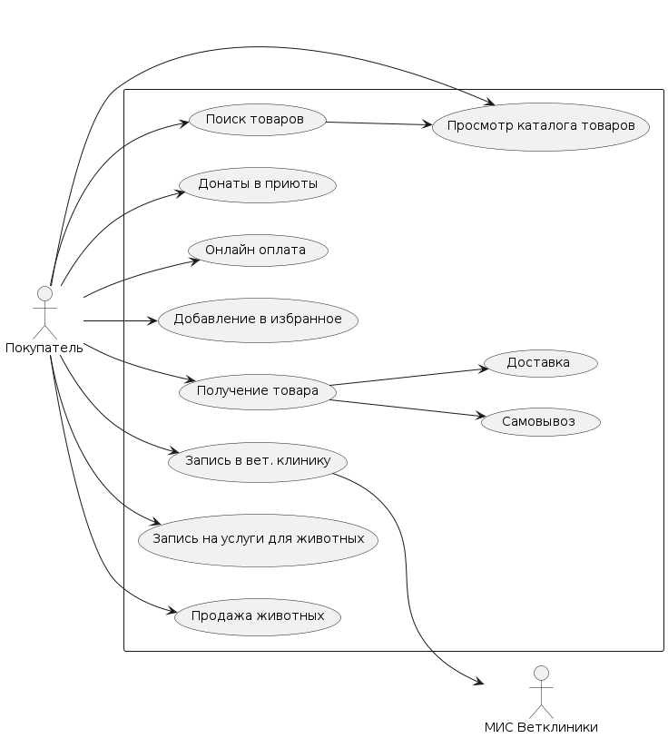
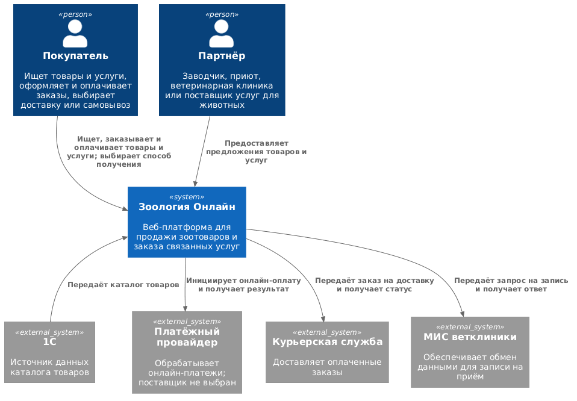
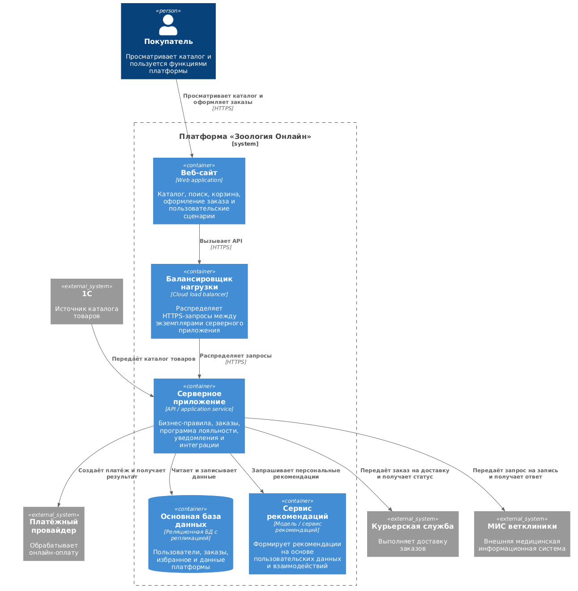

# «Зоология Онлайн» — интернет-магазин и сервисная платформа для владельцев животных

## Краткое описание

«Зоология Онлайн» — проект цифрового канала продаж сети зоомагазинов «Зоология» и развития связанных с заботой о животных услуг. Первая версия — адаптивный веб-сайт с каталогом и онлайн-оплатой; мобильное приложение рассматривается как возможный следующий этап.

Проект должен помочь сети перейти от продаж через социальные сети и мессенджеры к единой масштабируемой платформе, расширить географию продаж с Дальнего Востока на Центральную Россию и объединить покупателей, магазины и поставщиков услуг.

> **Статус документа:** концепция и исходные требования. Технический стек, поставщики интеграций, целевые показатели и детали архитектуры предстоит согласовать. Архитектурные схемы ниже показывают целевое предложение, а не подтверждённую реализацию.

## Бизнес-контекст

- **Заказчик:** сеть зоомагазинов «Зоология».
- **Текущая география:** 5 крупных городов Дальнего Востока, 20 магазинов.
- **Опыт онлайн-продаж:** около 6 месяцев через социальные сети и мессенджеры.
- **Текущая клиентская база:** около 1 500 человек; данные ведутся в Excel, идентификатор клиента — номер телефона.
- **Целевое расширение:** выход на рынок Центральной России.
- **Ориентировочный бюджет:** 15–20 млн рублей.
- **Горизонт развития:** до 2 лет.

## Цели и ожидаемая ценность

1. Создать единый онлайн-канал продаж с каталогом, поиском и оформлением заказа.
2. Упростить получение заказов за счёт доставки и самовывоза.
3. Подключить онлайн-оплату и обмен данными с 1С.
4. Повысить удержание покупателей с помощью уведомлений и программы лояльности.
5. Постепенно расширить платформу до пожертвований, записи в клиники и заказа услуг для животных.
6. Поддержать масштабирование бизнеса и рост нагрузки без потери надёжности пользовательских данных.

## Пользователи и участники

| Участник | Потребность / роль |
|---|---|
| Покупатель | Находить товары и услуги, оплачивать покупки, выбирать способ получения, сохранять избранное и получать уведомления |
| Сеть «Зоология» | Управлять онлайн-каналом продаж, каталогом, заказами и программой лояльности |
| Заводчик | Размещать предложения о продаже породистых животных на предусмотренном этапе развития |
| Приют | Получать пожертвования |
| Ветеринарная клиника | Принимать записи клиентов через интеграцию с медицинской информационной системой (МИС) |
| Поставщик услуг для животных | Предоставлять услуги, например стрижку, передержку и выгул |
| Курьерская служба | Доставлять заказ покупателю |

## Функциональный объём и этапы развития

| Период от старта | Возможности |
|---|---|
| 0–3 месяца | Продажа кормов и аксессуаров; каталог и поиск; заказ с онлайн-оплатой; доставка или самовывоз |
| 3–6 месяцев | Разовые и регулярные пожертвования приютам; предложения породистых животных от заводчиков |
| 6–12 месяцев | Запись в ветеринарные клиники с интеграцией с МИС |
| 12–18 месяцев | Заказ услуг для животных: стрижка, передержка, выгул и другие услуги |
| До 24 месяцев | Развитие рекомендаций, лояльности и уведомлений; оценка целесообразности мобильного приложения |

Сроки являются предварительными и уточняются при планировании релизов. Для первого этапа критичны каталог товаров, поиск, оформление заказа, онлайн-оплата и выбор способа получения.

## Основные бизнес-требования

- **Каталог:** загружать данные о товарах из 1С; предоставить просмотр каталога и поиск.
- **Заказы:** поддержать покупку товаров с оплатой онлайн. Оплата наличными не предусмотрена.
- **Получение заказа:** предоставить доставку курьером и самовывоз.
- **Клиентский профиль:** использовать номер телефона для идентификации; предусмотреть перенос и проверку качества данных из Excel.
- **Лояльность и коммуникации:** поддержать баллы, скидки и уведомления. Каналы, правила начисления и согласия на коммуникации необходимо определить отдельно.
- **Избранное и рекомендации:** дать возможность сохранять товары; развивать персональные рекомендации на основе пользовательских предпочтений и взаимодействий.
- **Развитие маркетплейса:** предусмотреть отдельные пользовательские сценарии для пожертвований, заводчиков, ветеринарных клиник и поставщиков услуг.
- **Платформы:** начать с сайта; мобильное приложение не входит в подтверждённый объём первого этапа.

## Нефункциональные требования и ограничения

- **Размещение:** облачная инфраструктура.
- **Масштабирование:** возможность распределять нагрузку между несколькими экземплярами приложения.
- **Надёжность данных:** репликация данных пользователей; целевые RPO/RTO, резервное копирование и план восстановления нужно согласовать.
- **Интеграции:** 1С — источник данных каталога; курьерская служба — доставка; МИС ветклиники — запись. Поставщика онлайн-оплаты и доступные интерфейсы интеграций требуется определить.
- **Персональные данные:** обработка клиентских данных и номера телефона должна быть спроектирована с учётом применимых требований законодательства и политики доступа.
- **Нагрузка и доступность:** количественные целевые показатели, география облака и требования к доступности предстоит зафиксировать до выбора инфраструктуры.

## UML: сценарии использования

На диаграмме показаны основные сценарии покупателя и связь записи к ветеринару с МИС клиники.

## C4: целевая архитектура

### Уровень 1 — системный контекст

### Уровень 2 — контейнеры (предварительное предложение)

## Предпосылки и вопросы для уточнения

- Какая система является источником истины для цен, остатков и статусов заказов: 1С, платформа или их согласованная комбинация?
- Какие API, форматы обмена и ограничения предоставляют 1С, курьерская служба и МИС клиник?
- Какой платёжный провайдер будет выбран и какие сценарии возвратов и отмен нужны?
- Как будут управляться профили и предложения партнёров (заводчиков, приютов и поставщиков услуг)?
- Каковы правила программы лояльности, подписок на пожертвования и уведомлений?
- Какие показатели нагрузки, доступности, RPO/RTO и хранения данных являются обязательными?
- Каковы целевые бизнес-метрики и их исходные значения: онлайн-выручка, конверсия, повторные покупки, доля успешно обработанных заказов?

## Критерии успеха

Целевые значения необходимо определить совместно с заказчиком до запуска. Рекомендуется отслеживать:

- долю заказов, оформленных через онлайн-канал;
- конверсию из просмотра каталога в оплаченный заказ;
- успешность оплаты и долю отменённых заказов;
- долю заказов, доставленных или выданных в срок;
- повторные покупки и использование программы лояльности;
- доступность сайта и восстановление данных после сбоя.
